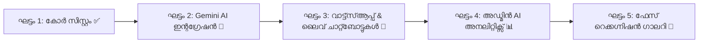

# 🌸 FRAMLU WEDDINGS - ആർക്കിടെക്ചർ & AI റോഡ്മാപ്പ് (Architecture & AI Roadmap)

ഈ ഡോക്യുമെന്റിൽ **Framlu Weddings / Wedding Planner Web Application**-ന്റെ ഫ്രണ്ട് എൻഡ് (Front-End), ബാക്ക് എൻഡ് (Back-End), ഡാറ്റാബേസ് (Database), ഓതന്റിക്കേഷൻ (Authentication), ഇന്റഗ്രേറ്റ് ചെയ്തിട്ടുള്ള/ചെയ്യുന്ന AI ലൈബ്രറികൾ (AI Libraries), സിസ്റ്റം ആർക്കിടെക്ചർ, സമഗ്രമായ ഭാവി റോഡ്മാപ്പ് (Full Development Roadmap) എന്നിവ വിശദമായി പ്രതിപാദിക്കുന്നു.

---

## 📑 ഉള്ളടക്കം (Table of Contents)
1. [പ്രോജക്റ്റ് അവലോകനം (Project Overview)](#1-പ്രോജക്റ്റ്-അവലോകനം-project-overview)
2. [ഫ്രണ്ട് എൻഡ് ആർക്കിടെക്ചർ (Front-End Architecture)](#2-ഫ്രണ്ട്-എൻഡ്-ആർക്കിടെക്ചർ-front-end-architecture)
3. [ബാക്ക് എൻഡ് & API റൂട്ടുകൾ (Back-End & API Routes)](#3-ബാക്ക്-എൻഡ്--api-റൂട്ടുകൾ-back-end--api-routes)
4. [ഡാറ്റാബേസ് & സ്റ്റോറേജ് സിസ്റ്റം (Database & Storage)](#4-ഡാറ്റാബേസ്--സ്റ്റോറേജ്-സിസ്റ്റം-database--storage)
5. [ഓതന്റിക്കേഷനും സെക്യൂരിറ്റിയും (Authentication & Security)](#5-ഓതന്റിക്കേഷനും-സെക്യൂരിറ്റിയും-authentication--security)
6. [ഇന്റഗ്രേറ്റ് ചെയ്യുന്ന AI ലൈബ്രറികൾ (AI Libraries & Capabilities)](#6-ഇന്റഗ്രേറ്റ്-ചെയ്യുന്ന-ai-ലൈബ്രറികൾ-ai-libraries--capabilities)
7. [സിസ്റ്റം ഡാറ്റാ ഫ്ലോ ഡയഗ്രം (System Data Flow)](#7-സിസ്റ്റം-ഡാറ്റാ-ഫ്ലോ-ഡയഗ്രം-system-data-flow)
8. [പൂർണ്ണ വികസന റോഡ്മാപ്പ് (Full Project Roadmap - Phases 1 to 5)](#8-പൂർണ്ണ-വികസന-റോഡ്മാപ്പ്-full-project-roadmap---phases-1-to-5)
9. [ഫോൾഡർ സ്ട്രക്ചറും ഫയൽ വിവരങ്ങളും (Directory Structure)](#9-ഫോൾഡർ-സ്ട്രക്ചറും-ഫയൽ-വിവരങ്ങളും-directory-structure)
10. [എൻവയോൺമെന്റ് സെറ്റപ്പ് (Environment Variables & Run Guide)](#10-എൻവയോൺമെന്റ്-സെറ്റപ്പ്-environment-variables--run-guide)

---

## 1. പ്രോജക്റ്റ് അവലോകനം (Project Overview)

**Framlu Weddings** എന്നത് കേരളത്തിലെ വിവാഹങ്ങൾക്കും മറ്റ് ഫോട്ടോഷൂട്ടുകൾക്കും (Pre-wedding, Post-wedding, Birthday, Baby shoot മുതലായവ) അനുയോജ്യമായ രീതിയിൽ രൂപകൽപ്പന ചെയ്ത ഒരു ആധുനിക ഫുൾ-സ്റ്റാക്ക് വെബ് ആപ്ലിക്കേഷനാണ്.
- **ഉപഭോക്താക്കൾക്ക് (Couples/Clients)**: തത്സമയ വിലനിലവാരം കണ്ട് സ്വന്തമായി ഇവന്റുകളും ക്രൂവും ആൽബങ്ങളും തിരഞ്ഞെടുത്ത് ഇൻസ്റ്റന്റ് PDF കൊട്ടേഷൻ ഡൗൺലോഡ് ചെയ്യാം.
- **സ്റ്റുഡിയോ പാർട്ണർമാർക്ക് (B2B Studio Partners)**: പ്രത്യേക ഡിസ്കൗണ്ടും കമ്മീഷൻ ടയറുകളുമുള്ള പാർട്ണർ പോർട്ടൽ.
- **അഡ്മിന് (Admin/Owner)**: വിലകൾ, ഓഫറുകൾ, ഗാലറി, ലീഡുകൾ, കൂപ്പണുകൾ എന്നിവ ലൈവായി നിയന്ത്രിക്കാനുള്ള തത്സമയ ക്ലൗഡ് കൺസോൾ.

---

## 2. ഫ്രണ്ട് എൻഡ് ആർക്കിടെക്ചർ (Front-End Architecture)

ഫ്രണ്ട് എൻഡ് നിർമ്മിച്ചിരിക്കുന്നത് ഏറ്റവും പുതിയ ആധുനിക വെബ് സാങ്കേതികവിദ്യകൾ ഉപയോഗിച്ചാണ്:

| സാങ്കേതികവിദ്യ (Technology) | വേർഷൻ (Version) | ഉപയോഗം (Role / Purpose) |
| :--- | :--- | :--- |
| **Next.js (App Router)** | `14.2.15` | React ഫ്രെയിംവർക്ക്, സെർവർ-സൈഡ് റെൻഡറിംഗ് (SSR), ക്ലയന്റ് കോംപോണന്റുകൾ, ഡൈനാമിക് റൂട്ടിംഗ്. |
| **React** | `18.3.1` | ഹൈ-പെർഫോമൻസ് റിയാക്റ്റീവ് യൂസർ ഇന്റർഫേസ് ഘടന. |
| **TypeScript** | `^5.0.0` | ടൈപ്പ്-സേഫ്റ്റി (Type-safety), ഡാറ്റാ മോഡലുകളുടെ സുരക്ഷിതത്വം. |
| **Tailwind CSS** | `^3.4.14` | റെസ്പോൺസീവ് ഡിസൈൻ, ആധുനിക ഗ്ലാസ്മോർഫിസം (Glassmorphism), മൊബൈൽ-ഫസ്റ്റ് ലേഔട്ട്. |
| **Lucide React** | `^0.453.0` | പ്രൊഫഷണൽ മിനിമൽ വെക്റ്റർ ഐക്കണുകൾ. |
| **Clsx & Tailwind-Merge** | `^2.1.1` & `^2.5.4` | ഡൈനാമിക് ക്ലാസ്സ് കോമ്പോസിഷനും സ്റ്റൈൽ കോൺഫ്ലിക്റ്റ് പ്രിവൻഷനും. |
| **jsPDF & html2canvas / html-to-image** | `^2.5.2` & `^1.4.1` | ക്ലയന്റ് ബ്രൗസറിൽ തന്നെ ഉയർന്ന റെസല്യൂഷനിൽ പ്രൊഫഷണൽ A4 PDF കൊട്ടേഷൻ ഉത്പാദിപ്പിക്കുന്നു. |

### പ്രധാന ഫ്രണ്ട് എൻഡ് കോംപോണന്റുകൾ (Key Components)
1. `Navbar.tsx`: ലോഗോ, കോൺടാക്റ്റ് നമ്പർ, ഭാഷ മാറ്റൽ (മലയാളം / English), കസ്റ്റമർ ലോഗിൻ, സ്റ്റുഡിയോ ലോഗിൻ, അഡ്മിൻ ലിങ്ക്.
2. `SideSelector.tsx`: വധുവിന്റെ ഭാഗം (Bride side), വരന്റെ ഭാഗം (Groom side), അല്ലെങ്കിൽ സംയുക്ത പാക്കേജ് (Combined) തിരഞ്ഞെടുക്കൽ.
3. `EventsCrewCustomizer.tsx`: വിവാഹ ചടങ്ങുകൾ (Engagement, Haldi, Sangeet, Wedding Ceremony, Reception) എന്നിവയ്ക്കുള്ള ഫോട്ടോഗ്രാഫർ, വീഡിയോഗ്രാഫർ, ഡ്രോൺ, ക്രെയിൻ, ലൈവ് സ്ട്രീമിംഗ് കോൺഫിഗറേഷൻ.
4. `DeliverablesCustomizer.tsx`: ആൽബങ്ങൾ (Traditional, Premium, Feather Touch, Canvera), ടീസർ/ഹൈലൈറ്റ് വീഡിയോ, 4K ഡോക്യുമെന്ററി, ഹാർഡ് ഡ്രൈവ്, ഫോട്ടോ ഫ്രെയിമുകൾ എന്നിവ കസ്റ്റമൈസ് ചെയ്യൽ.
5. `PhotoshootSection.tsx`: വിവാഹേതര ഫോട്ടോഷൂട്ടുകൾ (Pre/Post-wedding, Birthday, Baby shower, Newborn, Fashion photoshoot) തിരഞ്ഞെടുക്കൽ.
6. `LiveStickyPricing.tsx`: സ്ക്രീനിൽ താഴെ നിരന്തരം കാണുന്ന തത്സമയ വില കാൽക്കുലേറ്റർ, കൂപ്പൺ പ്രയോഗിക്കൽ, സ്മാർട്ട് ഓഫറുകൾ, PDF കൊട്ടേഷൻ ബട്ടൺ.
7. `OtherServicesSection.tsx`: കാറ്ററിംഗ്, സ്റ്റേജ് ഡെക്കറേഷൻ, ബ്രൈഡൽ മേക്കപ്പ്, വിവാഹ കാറുകൾ, DJ & ഇവന്റ് മാനേജ്‌മെന്റ്.
8. `GallerySection.tsx`: വീഡിയോ റീലുകളും ഫോട്ടോ പ്രോജക്റ്റുകളും അടങ്ങിയ ഫിൽട്ടറബിൾ പോർട്ട്‌ഫോളിയോ.
9. `AdminDashboard.tsx`: റേറ്റ് കാർഡ്, ബുക്കിംഗുകൾ, ലീഡുകൾ, ഓഫറുകൾ, ഗാലറി ഫോട്ടോകൾ, പാർട്ണർമാർ എന്നിവ മാറ്റാനുള്ള സമ്പൂർണ്ണ അഡ്മിൻ കൺസോൾ.

---

## 3. ബാക്ക് എൻഡ് & API റൂട്ടുകൾ (Back-End & API Routes)

ബാക്ക് എൻഡ് സെർവർലെസ്സ് (Serverless Architecture) രൂപത്തിലാണ് സജ്ജീകരിച്ചിരിക്കുന്നത്:

### സെർവർലെസ്സ് റൺടൈം (Serverless Runtime)
- **Next.js App Router Route Handlers (`src/app/api/...`)**: Node.js എൻവയോൺമെന്റിൽ പ്രവർത്തിക്കുന്ന ഉയർന്ന സ്കേലബിലിറ്റിയുള്ള സെർവർലെസ്സ് ഫംഗ്ഷനുകൾ.
- കോൾഡ് സ്റ്റാർട്ട് ഇല്ലാതെ വേഗത്തിൽ എക്സിക്യൂട്ട് ചെയ്യുന്നു.

### API എൻഡ്പോയിന്റുകൾ (Endpoints)
1. **`POST /api/auth/send-email-otp`**:
   - ഉപയോക്താവിന്റെ ഇമെയിലിലേക്ക് 6 അക്ക വെരിഫിക്കേഷൻ OTP അയക്കുന്നു.
   - സുരക്ഷയ്ക്കായി **HMAC SHA-256** ക്രിപ്റ്റോഗ്രാഫിക് ടോക്കൺ സെർവറിൽ നിർമ്മിച്ച് റെസ്പോൺസിൽ നൽകുന്നു (ഡാറ്റാബേസിൽ സ്റ്റോർ ചെയ്യാതെ തന്നെ വാലിഡേഷൻ സാധ്യമാക്കുന്ന സ്റ്റേറ്റ്‌ലെസ്സ് ആർക്കിടെക്ചർ).
   - **ഇമെയിൽ പ്രൊവൈഡർമാർ**: Resend API (`api.resend.com`) അല്ലെങ്കിൽ Brevo SMTP API (`api.brevo.com`).
2. **`POST /api/auth/verify-email-otp`**:
   - ഉപയോക്താവ് നൽകിയ OTP-യും HMAC ടോക്കണും പരിശോധിച്ച് ഇൻസ്റ്റന്റ് ഓതന്റിക്കേഷൻ പൂർത്തിയാക്കുന്നു.

---

## 4. ഡാറ്റാബേസ് & സ്റ്റോറേജ് സിസ്റ്റം (Database & Storage)

### പ്രൈമറി ഡാറ്റാബേസ്: Google Cloud Firestore (Firebase NoSQL)
തത്സമയ ഡാറ്റാ സിൻക്രൊണൈസേഷനും (Real-time Snapshot Listeners) കുറഞ്ഞ ലേറ്റൻസിയും നൽകുന്ന ഗൂഗിൾ ഫയർസ്റ്റോറാണ് ഡാറ്റാബേസായി ഉപയോഗിക്കുന്നത്.

#### കളക്ഷനുകളും ഡോക്യുമെന്റുകളും (Firestore Schema):
- **`settings/studio_contact`**: സ്റ്റുഡിയോയുടെ പേര്, വിലാസം, ഫോൺ, ഇമെയിൽ, UPI/ബാങ്ക് അക്കൗണ്ട് വിവരങ്ങൾ, സോഷ്യൽ മീഡിയ ലിങ്കുകൾ.
- **`settings/price_rates`**: ഫോട്ടോഗ്രാഫർമാർ, വീഡിയോഗ്രാഫർമാർ, ഡ്രോൺ, ക്രെയിൻ, ആൽബങ്ങൾ, കാൻഡിഡ് ഷൂട്ട് എന്നിവയുടെ ബേസ് റേറ്റുകൾ.
- **`settings/custom_prints`**: ആൽബം ആഡ്-ഓണുകൾ, ക്യാൻവാസ് പ്രിന്റുകൾ, കലണ്ടറുകൾ.
- **`settings/promo_offers`**: ഡിസ്കൗണ്ട് ഓഫറുകൾ, ഫ്ലാഷ് സെയിൽ കാമ്പെയ്നുകൾ.
- **`settings/highlight_boards`**: മുൻകൂട്ടി തയ്യാറാക്കിയ ജനപ്രിയ പാക്കേജുകൾ (Popular Packages).
- **`settings/other_services`**: കാറ്ററിംഗ്, സ്റ്റേജ് ഡെക്കറേഷൻ, മേക്കപ്പ് ആർട്ടിസ്റ്റുകൾ, ലക്ഷ്വറി കാർ റെന്റലുകൾ.
- **`settings/service_categories`**: സർവീസ് കാറ്റഗറികൾ.
- **`settings/gallery_projects`**: പോർട്ട്‌ഫോളിയോ ഫോട്ടോകളും യൂട്യൂബ് വീഡിയോ ലിങ്കുകളും.
- **`settings/coupon_codes`**: പ്രൊമോഷണൽ കൂപ്പൺ കോഡുകൾ (ശതമാനം അല്ലെങ്കിൽ ഫ്ലാറ്റ് ഡിസ്കൗണ്ട്).
- **`settings/photoshoot_packages`**: പ്രീ-വെഡ്ഡിംഗ്, ബേബി ഷൂട്ട് പാക്കേജ് വിവരങ്ങൾ.
- **`leads` (Collection)**: കസ്റ്റമറുകൾ തയ്യാറാക്കിയ കൊട്ടേഷനുകൾ, പേര്, ഫോൺ, വിവാഹ തീയതി, സ്ഥലം, ടോട്ടൽ ബജറ്റ്, ബുക്കിംഗ് സ്റ്റാറ്റസ്.
- **`studio_partners` (Collection)**: രജിസ്റ്റർ ചെയ്ത ഫോട്ടോഗ്രാഫി സ്റ്റുഡിയോകൾ, കമ്മീഷൻ ശതമാനം, ബിസിനസ്സ് വിവരങ്ങൾ.

### ഓഫ്‌ലൈൻ കാഷെ (Offline LocalStorage Layer)
- ഇന്റർനെറ്റ് കണക്ഷൻ മന്ദഗതിയിലായാലും തടസ്സമില്ലാതെ പ്രവർത്തിക്കാൻ ബ്രൗസറിലെ `localStorage` ഓട്ടോമാറ്റിക് കാഷെ ആയി പ്രവർത്തിക്കുന്നു.

### മീഡിയ സ്റ്റോറേജ്: Firebase Cloud Storage
- ഫോട്ടോകൾ, പ്രോജക്റ്റ് ഇമേജുകൾ, ആൽബം പ്രിവ്യൂകൾ എന്നിവ സൂക്ഷിക്കാൻ `frameluweddings.firebasestorage.app`.

---

## 5. ഓതന്റിക്കേഷനും സെക്യൂരിറ്റിയും (Authentication & Security)

1. **കസ്റ്റമർ ഓതന്റിക്കേഷൻ (Customer Auth)**:
   - മൊബൈൽ നമ്പർ / ഇമെയിൽ അടിസ്ഥാനമാക്കിയുള്ള OTP വെരിഫിക്കേഷൻ.
   - HMAC ടോക്കൺ ബേസ്ഡ് വെരിഫിക്കേഷൻ വഴി സ്പാമും ഫ്രോഡും തടയുന്നു.
2. **സ്റ്റുഡിയോ പാർട്ണർ ഓതന്റിക്കേഷൻ (B2B Partner Auth)**:
   - ഫോട്ടോഗ്രാഫി സ്റ്റുഡിയോകൾക്ക് അവരുടെ മൊബൈൽ നമ്പർ, പാസ്‌വേഡ് / OTP എന്നിവ വഴി ലോഗിൻ ചെയ്ത് സ്പെഷ്യൽ B2B പാർട്ണർ റേറ്റിൽ കൊട്ടേഷൻ നൽകാനുള്ള സൗകര്യം.
3. **അഡ്മിൻ സുരക്ഷ (Admin Security)**:
   - അഡ്മിൻ ഡാഷ്‌ബോർഡിലേക്ക് പ്രവേശിക്കാൻ സെക്യുർ മാസ്റ്റർ പിൻ (Secure Master PIN) ഓതന്റിക്കേഷൻ.

---

## 6. ഇന്റഗ്രേറ്റ് ചെയ്യുന്ന AI ലൈബ്രറികൾ (AI Libraries & Capabilities)

വിവാഹ പ്ലാനിംഗ് കൂടുതൽ എളുപ്പമാക്കാനും സ്മാർട്ടാക്കാനും താഴെ പറയുന്ന AI ലൈബ്രറികളും മോഡലുകളുമാണ് ഇന്റഗ്രേറ്റ് ചെയ്യുന്നത്:

### 🤖 നിർദ്ദേശിച്ചിരിക്കുന്ന AI ലൈബ്രറികൾ (Integrated / Proposed AI Libraries)

| AI ലൈബ്രറി (Library) | മോഡൽ (Model) | ഉദ്ദേശ്യം / ഫീച്ചർ (AI Feature in App) |
| :--- | :--- | :--- |
| **`@google/genai`** (Google Gemini SDK) | **Gemini 2.5 Flash / Gemini 3.8** | **AI വെഡ്ഡിംഗ് ബജറ്റ് ഒപ്റ്റിമൈസർ (Smart Budget Optimizer)**: കസ്റ്റമറുടെ ബജറ്റിന് അനുയോജ്യമായ ഏറ്റവും മികച്ച ക്രൂവിനെയും ഡെലിവറബിളുകളെയും ഓട്ടോമാറ്റിക്കായി നിർദ്ദേശിക്കുന്നു. |
| **Gemini Multilingual LLM** | **Gemini 2.5 Pro / Flash** | **ദ്വിഭാഷാ AI അസിസ്റ്റന്റ് (Bilingual Malayalam & English Assistant)**: മലയാളത്തിലും ഇംഗ്ലീഷിലും കസ്റ്റമറുടെ സംശയങ്ങൾക്ക് 24/7 തത്സമയ മറുപടിയും പാക്കേജ് ഗൈഡൻസും നൽകുന്ന ചാറ്റ്ബോട്ട്. |
| **Gemini Structured Output** | **Function Calling / JSON Schema** | **AI കലണ്ടർ & മുഹൂർത്തം ഷെഡ്യൂളർ (AI Event Timeline Planner)**: വിവാഹ തീയതിയും മുഹൂർത്തവും നൽകിയാൽ ഫോട്ടോഗ്രാഫർമാർക്കും വധൂവരന്മാർക്കുമായി മിനിറ്റ്-ടു-മിനിറ്റ് ഫോട്ടോ-ഷൂട്ട് ഷെഡ്യൂൾ തയ്യാറാക്കുന്നു. |
| **LangChain / GenAI Embeddings** | **text-embedding-004** | **സ്മാർട്ട് ലീഡ് സ്കോറിംഗ് (Smart Lead Scoring)**: അഡ്മിൻ കൺസോളിൽ വന്നിരിക്കുന്ന ലീഡുകളിൽ ഏറ്റവും വേഗത്തിൽ കൺവേർട്ട് ചെയ്യാൻ സാധ്യതയുള്ളവരെ AI റാങ്ക് ചെയ്യുന്നു. |
| **Face-API.js / AWS Rekognition / Clarifai** | **Computer Vision** | **ഫേസ് റെക്കഗ്നിഷൻ ഗസ്റ്റ് ഗാലറി (AI Guest Photo Finder)**: കല്യാണത്തിൽ പങ്കെടുത്ത അതിഥികൾക്ക് സ്വന്തം സെൽഫി അപ്‌ലോഡ് ചെയ്താൽ ഗാലറിയിൽ നിന്ന് അവരുടെ ഫോട്ടോകൾ മാത്രം കണ്ടെത്താനുള്ള ഫീച്ചർ. |

---

## 7. സിസ്റ്റം ഡാറ്റാ ഫ്ലോ ഡയഗ്രം (System Data Flow)

```mermaid
flowchart TD
    User([കസ്റ്റമർ / ഉപയോക്താവ്]) -->|സന്ദർശിക്കുന്നു| UI[Next.js 14 Client App]
    UI -->|ചടങ്ങുകളും ക്രൂവും തിരഞ്ഞെടുക്കുന്നു| Calc[utils/calculator.ts]
    Calc -->|തത്സമയ നിരക്ക് പ്രദർശിപ്പിക്കുന്നു| Sticky[LiveStickyPricing]
    
    UI -->|OTP അഭ്യർത്ഥിക്കുന്നു| API_OTP[/api/auth/send-email-otp]
    API_OTP -->|ഇമെയിൽ അയക്കുന്നു| EmailService[Resend / Brevo API]
    EmailService -->|OTP കോഡ്| UserEmail[കസ്റ്റമറുടെ ഇമെയിൽ]
    
    User -->|OTP നൽകി സ്ഥിരീകരിക്കുന്നു| API_Verify[/api/auth/verify-email-otp]
    API_Verify -->|HMAC Token വാലിഡേഷൻ| UI
    
    UI -->|കൊട്ടേഷൻ സേവ് ചെയ്യുന്നു| FirestoreDB[(Google Cloud Firestore)]
    FirestoreDB -->|തത്സമയം സിൻക് ചെയ്യുന്നു| Admin[അഡ്മിൻ ഡാഷ്‌ബോർഡ്]
    
    UI -->|AI അസിസ്റ്റന്റ് ചോദ്യങ്ങൾ| AI_API[Next.js Gemini AI Route]
    AI_API -->|പ്രോംപ്റ്റ് പ്രൊസസ്സിംഗ്| Gemini[Google Gemini AI Engine]
    Gemini -->|സ്മാർട്ട് പാക്കേജ് & ഷെഡ്യൂൾ ശുപാർശകൾ| UI
    
    UI -->|PDF ഡൗൺലോഡ് ചെയ്യുന്നു| PDF[jsPDF + html2canvas Client Engine]
    PDF -->|പ്രൊഫഷണൽ കൊട്ടേഷൻ| ClientDevice[കസ്റ്റമറുടെ ഫോൺ / കമ്പ്യൂട്ടർ]
```

---

## 8. പൂർണ്ണ വികസന റോഡ്മാപ്പ് (Full Project Roadmap - Phases 1 to 5)



### 📍 ഘട്ടം 1: അടിത്തറയും കോർ ഫീച്ചറുകളും (Phase 1: Core Foundation - നിലവിൽ പൂർത്തിയായവ ✅)
- [x] Next.js 14, Tailwind CSS, TypeScript സജ്ജീകരണം.
- [x] വധു/വരൻ/സംയുക്ത സൈഡ് സെലക്ഷൻ ലോജിക്.
- [x] കേരള ട്രഡീഷണൽ ചടങ്ങുകൾക്കായുള്ള ക്രൂ കാൽക്കുലേറ്റർ (Traditional, Candid, Drone, Live Streaming).
- [x] ആൽബം ടൈപ്പുകൾ, ഫോട്ടോ ഫ്രെയിമുകൾ, ടീസർ/റീൽസ് കസ്റ്റമൈസേഷൻ.
- [x] തത്സമയ വിലനിലവാരം (Live Sticky Pricing Calculation).
- [x] ക്ലയന്റ്-സൈഡ് ഹൈ-ക്വാളിറ്റി A4 PDF കൊട്ടേഷൻ ജനറേഷൻ.
- [x] സുരക്ഷിതമായ ക്രിപ്റ്റോഗ്രാഫിക് Email OTP സിസ്റ്റം (Resend/Brevo ഇന്റഗ്രേഷൻ).
- [x] ഗൂഗിൾ ഫയർസ്റ്റോർ തത്സമയ സിൻക്രൊണൈസേഷൻ (Settings, Leads, Rates, Offers, Coupons).
- [x] ഇംഗ്ലീഷ് & മലയാളം ദ്വിഭാഷാ ഇന്റർഫേസ് (Bilingual Language Switcher).
- [x] സൂപ്പർ അഡ്മിൻ ഡാഷ്‌ബോർഡും ലീഡ് മാനേജ്‌മെന്റും.
- [x] B2B സ്റ്റുഡിയോ പാർട്ണർ രജിസ്ട്രേഷനും പ്രത്യേക പോർട്ടലും.

---

### 📍 ഘട്ടം 2: Gemini AI ഇന്റഗ്രേഷൻ (Phase 2: Generative AI Suite 🚀 - അടുത്ത ഘട്ടം)
- [ ] **`@google/genai` ലൈബ്രറി ഇൻസ്റ്റാളേഷൻ**:
  - `npm install @google/genai`
- [ ] **AI സ്മാർട്ട് പാക്കേജ് റെക്കമെൻഡർ (AI Package Recommender)**:
  - ഉപയോക്താവ് അവരുടെ ബജറ്റും (ഉദാഹരണത്തിന് ₹1,50,000) മുൻഗണനകളും (ഉദാഹരണത്തിന് മികച്ച ആൽബവും ഡ്രോണും വേണം) നൽകിയാൽ കൃത്യമായ ക്രൂ കോമ്പിനേഷൻ തനിയെ സെലക്റ്റ് ചെയ്തു നൽകുന്ന ഫീച്ചർ.
- [ ] **AI വെഡ്ഡിംഗ് ഷെഡ്യൂളർ (AI Timeline Generator)**:
  - മുഹൂർത്ത സമയം, താലികെട്ട്, റിസപ്ഷൻ സമയം എന്നിവ നൽകിയാൽ ഫോട്ടോഗ്രാഫർമാർ എപ്പോൾ എത്തണം, കപ്പിൾ പോർട്രെയ്റ്റ് എപ്പോൾ എടുക്കണം എന്ന് കാണിക്കുന്ന മിനിറ്റ്-ടു-മിനിറ്റ് ടൈംടേബിൾ ഓട്ടോമാറ്റിക്കായി തയ്യാറാക്കി PDF-ൽ ചേർക്കൽ.
- [ ] **AI പ്രൊപ്പോസൽ പിച്ച് ലെറ്റർ (AI Proposal Letter)**:
  - കസ്റ്റമറുടെ പേരിലും അവരുടെ വിവാഹ സ്വപ്നങ്ങൾക്ക് അനുയോജ്യമായ രീതിയിലും മനോഹരമായ മലയാളത്തിലും ഇംഗ്ലീഷിലും വ്യക്തിഗത ആശംസയും കവറിംഗ് ലെറ്ററും PDF-ൽ AI തനിയെ എഴുതുന്നു.

---

### 📍 ഘട്ടം 3: വാട്ട്‌സ്ആപ്പ് & ലൈവ് ചാറ്റ്ബോട്ടുകൾ (Phase 3: Conversational AI & WhatsApp 💬)
- [ ] **മലയാളം AI ചാറ്റ് അസിസ്റ്റന്റ് (Malayalam Chatbot Widget)**:
  - സൈറ്റിൽ വരുന്നവർക്ക് ഫോട്ടോഗ്രാഫി പാക്കേജുകൾ, ലൊക്കേഷൻ നിർദ്ദേശങ്ങൾ എന്നിവ മലയാളത്തിൽ ചോദിച്ചറിയാനുള്ള ഇന്ററാക്ടീവ് AI വിഡ്ജറ്റ്.
- [ ] **WhatsApp Cloud API ഇന്റഗ്രേഷൻ**:
  - കസ്റ്റമർ കൊട്ടേഷൻ തയ്യാറാക്കിയ ഉടൻ തന്നെ അവരുടെ വാട്ട്‌സ്ആപ്പിലേക്ക് PDF കൊട്ടേഷനും വിശദാംശങ്ങളും ഓട്ടോമാറ്റിക്കായി അയച്ചു നൽകൽ.
- [ ] **സ്റ്റുഡിയോ ഓട്ടോ-അലേർട്ട്**:
  - പുതിയ ലീഡ് വരുമ്പോൾ തന്നെ സ്റ്റുഡിയോ മാനേജർക്ക് വാട്ട്‌സ്ആപ്പിൽ ഇൻസ്റ്റന്റ് നോട്ടിഫിക്കേഷൻ.

---

### 📍 ഘട്ടം 4: അഡ്മിൻ ബിസിനസ്സ് അനലിറ്റിക്സും CRM ഉം (Phase 4: Admin AI Intelligence 📊)
- [ ] **AI ലീഡ് പ്രയോറിറ്റൈസേഷൻ (Smart Lead Scoring)**:
  - ഏതെല്ലാം കസ്റ്റമർമാരാണ് വേഗത്തിൽ ബുക്കിംഗ് നടത്താൻ സാധ്യതയുള്ളതെന്ന് മുൻഗണനാ ക്രമത്തിൽ ലിസ്റ്റ് ചെയ്യൽ.
- [ ] **ഡൈനാമിക് സീസണൽ പ്രൈസിംഗ് ശുപാർശകൾ**:
  - വിവാഹ സീസണുകളിൽ (മുഹൂർത്ത ദിനങ്ങൾ) ഡിമാൻഡ് അനുസരിച്ച് ഓഫറുകളും നിരക്കുകളും ക്രമീകരിക്കാനുള്ള AI നിർദ്ദേശങ്ങൾ.
- [ ] **ഓട്ടോമേറ്റഡ് ഇമെയിൽ / SMS ഫോളോ-അപ്പുകൾ**:
  - കൊട്ടേഷൻ എടുത്തതിനു ശേഷം സ്ഥിരീകരിക്കാത്ത ഉപയോക്താക്കൾക്ക് സൗഹാർദ്ദപരമായ ഓർമ്മപ്പെടുത്തൽ മെയിലുകൾ.

---

### 📍 ഘട്ടം 5: കമ്പ്യൂട്ടർ വിഷൻ & ഫേസ് റെക്കഗ്നിഷൻ ഗാലറി (Phase 5: AI Photo Delivery 📸)
- [ ] **AI ഫേസ് റെക്കഗ്നിഷൻ സെർച്ച് (Guest Face Recognition)**:
  - വിവാഹത്തിന് പങ്കെടുത്ത അതിഥികൾക്ക് സ്വന്തം ഫോട്ടോ അപ്‌ലോഡ് ചെയ്താൽ കല്യാണ ഫോട്ടോകളുടെ വലിയ ആൽബത്തിൽ നിന്നും അവരുടെ ഫോട്ടോകൾ മാത്രം നിമിഷനേരം കൊണ്ട് കണ്ടെത്താനുള്ള ഫീച്ചർ.
- [ ] **സ്മാർട്ട് ഫോട്ടോ ക്യൂറേഷൻ**:
  - ബ്ലർ ആയതും കണ്ണടഞ്ഞു പോയതുമായ ഫോട്ടോകളെ ഒഴിവാക്കി മികച്ച ചിത്രങ്ങൾ മാത്രം ആൽബത്തിനായി തിരഞ്ഞെടുക്കാൻ ഫോട്ടോഗ്രാഫർമാരെ സഹായിക്കുന്ന AI ടൂൾ.

---

## 9. ഫോൾഡർ സ്ട്രക്ചറും ഫയൽ വിവരങ്ങളും (Directory Structure)

```
Wedding_Planner_App/
├── src/
│   ├── app/                                 # Next.js 14 App Router റൂട്ടുകൾ
│   │   ├── layout.tsx                       # മെയിൻ ആപ്പ് ലേഔട്ടും മെറ്റാഡാറ്റയും
│   │   ├── page.tsx                         # പ്രധാന വെഡ്ഡിംഗ് പ്ലാനർ ലാൻഡിംഗ് പേജ്
│   │   ├── globals.css                      # Tailwind ഗ്ലോബൽ സ്റ്റൈലുകൾ
│   │   ├── admin/
│   │   │   └── page.tsx                     # അഡ്മിൻ കൺസോൾ റൂട്ട് (/admin)
│   │   └── api/
│   │       └── auth/
│   │           ├── send-email-otp/          # OTP അയക്കുന്ന സെർവർലെസ്സ് എൻഡ്പോയിന്റ്
│   │           │   └── route.ts
│   │           └── verify-email-otp/        # OTP പരിശോധിക്കുന്ന സെർവർലെസ്സ് എൻഡ്പോയിന്റ്
│   │               └── route.ts
│   ├── components/                          # പുനരുപയോഗിക്കാവുന്ന UI കോംപോണന്റുകൾ
│   │   ├── Navbar.tsx                       # ഹെഡറും നാവിഗേഷനും
│   │   ├── SideSelector.tsx                 # വധു / വരൻ / സംയുക്ത സെലക്ഷൻ
│   │   ├── EventsCrewCustomizer.tsx         # ഇവന്റുകളും ക്രൂ സെലക്ഷനും
│   │   ├── DeliverablesCustomizer.tsx       # ആൽബം, വീഡിയോ, ഹാർഡ് ഡ്രൈവ് സെലക്ഷൻ
│   │   ├── PhotoshootSection.tsx            # മറ്റ് ഫോട്ടോഷൂട്ട് കാറ്റഗറികൾ
│   │   ├── LiveStickyPricing.tsx            # തത്സമയ വില കാൽക്കുലേറ്ററും ബാറും
│   │   ├── PdfQuotationView.tsx             # A4 പ്രൊഫഷണൽ കൊട്ടേഷൻ പ്രിവ്യൂ
│   │   ├── LeadCaptureModal.tsx             # കസ്റ്റമർ കോൺടാക്റ്റ് ഫോം മോഡൽ
│   │   ├── CustomerAuthModal.tsx            # ഉപഭോക്തൃ ലോഗിൻ / OTP മോഡൽ
│   │   ├── StudioAuthModal.tsx              # സ്റ്റുഡിയോ പാർട്ണർ B2B ലോഗിൻ മോഡൽ
│   │   ├── AdminLoginModal.tsx              # അഡ്മിൻ പിൻ വെരിഫിക്കേഷൻ മോഡൽ
│   │   ├── AdminDashboard.tsx               # അഡ്മിൻ കൺട്രോൾ സെന്റർ
│   │   ├── OffersAndHighlightBoards.tsx     # ഓഫറുകളും ബാനറുകളും
│   │   ├── OtherServicesSection.tsx         # കാറ്ററിംഗ്, ഡെക്കറേഷൻ, മേക്കപ്പ്
│   │   └── GallerySection.tsx               # ഫോട്ടോ/വീഡിയോ പോർട്ട്ഫോളിയോ
│   ├── constants/
│   │   ├── defaults.ts                      # ഡിഫോൾട്ട് റേറ്റുകളും പാക്കേജുകളും
│   │   └── translations.ts                  # മലയാളം / English നിഘണ്ടു
│   ├── lib/
│   │   ├── firebase.ts                      # ഫയർബേസ് ആപ്പ് & ക്ലൗഡ് ഫയർസ്റ്റോർ ഇനിഷ്യലൈസേഷൻ
│   │   ├── firestoreSync.ts                 # തത്സമയ ക്ലൗഡ് സമന്വയ ഫംഗ്ഷനുകൾ
│   │   └── emailOtp.ts                      # HMAC ടോക്കൺ ജനറേഷനും ഇമെയിൽ ഡിസ്പാച്ചും
│   ├── types/
│   │   └── index.ts                         # എല്ലാ TypeScript ഇന്റർഫേസുകളും ടൈപ്പുകളും
│   └── utils/
│       └── calculator.ts                    # വില കണക്കുകൂട്ടുന്ന ലോജിക്
├── public/                                  # ഇമേജുകൾ, ഐക്കണുകൾ, ഫോണ്ടുകൾ
├── .env.example                             # എൻവയോൺമെന്റ് വേരിയബിളുകളുടെ മാതൃക
├── .env.local                               # ലോക്കൽ രഹസ്യ കോഡുകൾ (API Keys)
├── package.json                             # പ്രോജക്റ്റ് ഡിപൻഡൻസികൾ
├── tailwind.config.ts                       # ടെയിൽവിൻഡ് കോൺഫിഗറേഷൻ
├── tsconfig.json                            # ടൈപ്പ്സ്ക്രിപ്റ്റ് കോൺഫിഗറേഷൻ
└── PROJECT_ARCHITECTURE_AND_ROADMAP.md      # സമഗ്ര സാങ്കേതിക വിവരങ്ങളും റോഡ്മാപ്പും
```

---

## 10. എൻവയോൺമെന്റ് സെറ്റപ്പ് (Environment Variables & Run Guide)

### `.env.local` ഫയലിൽ നൽകേണ്ട വേരിയബിളുകൾ:

```bash
# 1. Resend API Key (https://resend.com വഴി സൗജന്യമായി ലഭിക്കുന്നത്)
RESEND_API_KEY=re_your_api_key_here

# 2. Brevo API Key (ഓപ്ഷണൽ ഇമെയിൽ ബാക്കപ്പ് - https://brevo.com)
BREVO_API_KEY=

# 3. അയക്കുന്നയാളുടെ ഇമെയിൽ വിലാസം
EMAIL_FROM=onboarding@resend.dev

# 4. ക്രിപ്റ്റോഗ്രാഫിക് OTP സുരക്ഷാ കീ
OTP_SECRET=framlu-weddings-otp-secret-key-2026

# 5. Gemini AI API Key (ഘട്ടം 2-ൽ AI ആക്റ്റിവേറ്റ് ചെയ്യാൻ - https://aistudio.google.com)
GEMINI_API_KEY=your_gemini_api_key_here
```

### പ്രോജക്റ്റ് പ്രവർത്തിപ്പിക്കാൻ:

```bash
# ഡിപൻഡൻസികൾ ഇൻസ്റ്റാൾ ചെയ്യാൻ
npm install

# ഡെവലപ്‌മെന്റ് സെർവർ റൺ ചെയ്യാൻ
npm run dev
# തുടർന്ന് ബ്രൗസറിൽ http://localhost:3000 സന്ദർശിക്കുക

# പ്രൊഡക്ഷൻ ബിൽഡ് എടുക്കാൻ
npm run build
```

---

*തയ്യാറാക്കിയത്: Framlu Weddings Engineering Team*  
*അവസാനം അപ്‌ഡേറ്റ് ചെയ്ത തീയതി: ഒക്ടോബർ 2026*
